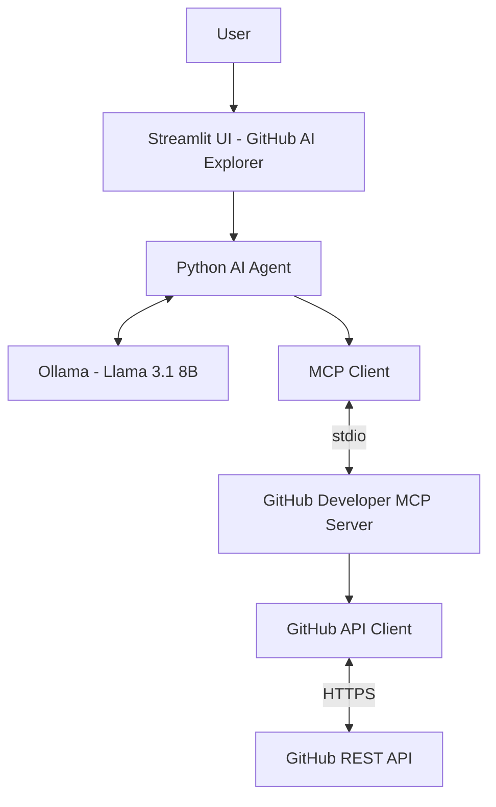

# GitHub Developer MCP Server

A Python-based Model Context Protocol (MCP) server that exposes GitHub repository information and development workflows as tools for AI applications.

## Overview

Understanding an unfamiliar GitHub repository often requires manually exploring its README, directory structure, dependencies, commits, issues, and pull requests.

The GitHub Developer MCP Server addresses this by providing a collection of MCP tools that allow AI applications to interact with GitHub through a standardized interface.

The server communicates with GitHub using the GitHub REST API and exposes repository information through MCP tools. An AI client can discover these tools, execute them based on user queries, and use the returned information to generate meaningful technical insights.

The project also includes **GitHub AI Explorer**, a Streamlit-based application that combines the MCP server with a local Large Language Model to provide a conversational interface for exploring GitHub repositories.

## Key Features

- **Repository Intelligence:** Collects repository metadata, README content, programming languages, directory structure, dependency manifests, and recent commits.
- **Repository Information:** Retrieves repository metadata, including stars, forks, default branch, and description.
- **Language Analysis:** Retrieves programming language statistics for repositories.
- **Repository Exploration:** Fetches README files and recursively explores repository directory structures.
- **Dependency Inspection:** Identifies and retrieves supported dependency manifest files.
- **Commit Analysis:** Retrieves recent commits and detailed commit information.
- **Issue Management:** Lists repository issues and retrieves individual issue details.
- **Pull Request Inspection:** Lists pull requests and retrieves detailed information about individual pull requests.
- **AI-Powered Interaction:** Uses a local LLM to interpret user questions, select appropriate MCP tools, and generate responses.
- **Interactive Interface:** Provides a Streamlit-based chat interface for interacting with GitHub repositories.

## Architecture



The application follows a client-server architecture using the Model Context Protocol.

The user interacts with the Streamlit interface, which forwards the query to the Python AI agent. The agent uses the local LLM to determine which MCP tools are required to answer the query.

The MCP client communicates with the GitHub Developer MCP Server through standard input/output (stdio). The server processes the requested tool, communicates with the GitHub REST API, and returns the retrieved information.

The AI agent then uses the returned information to generate a response, which is displayed in the Streamlit interface.

The MCP server is responsible for providing GitHub data and tools. The LLM-based reasoning and response generation happen separately inside the AI client.

## Technology Stack

| Component | Technology |
|---|---|
| Programming Language | Python 3.12 |
| MCP Framework | MCP Python SDK |
| GitHub Integration | GitHub REST API |
| HTTP Client | HTTPX |
| AI Agent | Custom Python AI Agent |
| Large Language Model | Llama 3.1 8B |
| Local Model Runtime | Ollama |
| User Interface | Streamlit |
| Package Management | uv |
| Communication Protocol | MCP over stdio |

## How It Works

### 1. MCP Server Initialization

The MCP server is implemented using the Python MCP SDK.

It registers a collection of tools that expose different GitHub operations. These tools allow an MCP client to retrieve repository information without directly implementing GitHub API operations.

The server is launched by the MCP client as a separate process and communicates through stdio.

### 2. GitHub API Integration

The GitHub API client handles communication with the GitHub REST API using HTTPX.

It is responsible for:

- Sending asynchronous HTTP requests.
- Retrieving repository information.
- Handling API responses.
- Supporting authenticated requests through an optional GitHub personal access token.

### 3. Repository Intelligence

The `get_repository_overview` tool collects multiple categories of technical information about a repository.

It retrieves:

- Repository metadata.
- Programming language statistics.
- README content.
- Recursive repository file tree.
- Dependency manifests.
- Recent commits.

The collected information is organized into a structured response that can be consumed by an AI application.

### 4. AI Agent and Tool Execution

The Python AI agent connects to the MCP server and discovers the tools exposed by it.

When a user submits a question:

1. The agent sends the user's query and available tool definitions to the local LLM.
2. The LLM determines which tool or tools are required.
3. The agent executes the selected MCP tools through the MCP client.
4. The retrieved information is passed back to the LLM.
5. The LLM generates a response based on the retrieved repository information.

This allows the application to answer repository-related questions using actual GitHub data instead of relying entirely on the model's existing knowledge.

### 5. Streamlit Interface

GitHub AI Explorer provides a conversational interface for interacting with the AI agent.

The interface allows users to:

- Ask questions about GitHub repositories.
- Explore repository architecture and dependencies.
- Inspect commits and development activity.
- Retrieve information about issues and pull requests.
- View AI-generated technical explanations.

The application uses Ollama to run the Llama 3.1 8B model locally.

## Getting Started

### Prerequisites

Make sure the following are installed:

- Python 3.12+
- uv
- Ollama
- Git

### 1. Clone the Repository

```bash
git clone <your-repository-url>
cd github-developer-mcp-server
```

### 2. Install Dependencies

Install the project dependencies using uv:

```bash
uv sync
```

### 3. Configure Environment Variables

Create a `.env` file in the project root:

```env
GITHUB_TOKEN=your_github_personal_access_token
```

A GitHub personal access token is optional but recommended to improve API rate limits.

Make sure the `.env` file is included in `.gitignore` and is never committed to the repository.

### 4. Set Up Ollama

Install Ollama from:

https://ollama.com

Pull the required model:

```bash
ollama pull llama3.1:8b
```

Make sure the Ollama service is running:

```bash
ollama serve
```

If Ollama is already running as a background service, this step is not necessary.

### 5. Run the Application

Start the Streamlit application:

```bash
uv run streamlit run src/github_mcp/ui/app.py
```

The application will be available at:

```text
http://localhost:8501
```

The application initializes the AI agent, MCP client, and MCP server connection when the interface starts.

## MCP Tools

The server currently exposes the following 13 tools:

| Tool | Description |
|---|---|
| `get_repository_overview` | Collects comprehensive technical information about a repository. |
| `get_repository` | Retrieves repository metadata. |
| `get_languages` | Retrieves programming language statistics. |
| `list_repositories` | Lists recently updated public repositories of a GitHub user. |
| `get_repository_readme` | Retrieves the repository README. |
| `get_repository_tree` | Retrieves the recursive repository directory structure. |
| `get_dependency_manifests` | Retrieves supported dependency manifest files. |
| `get_commits` | Retrieves recent repository commits. |
| `get_commit_details` | Retrieves detailed information about a specific commit. |
| `list_issues` | Lists repository issues. |
| `get_issue` | Retrieves details about a specific issue. |
| `list_pull_requests` | Lists repository pull requests. |
| `get_pull_request` | Retrieves details about a specific pull request. |

## Example Usage

After starting GitHub AI Explorer, users can ask questions such as:

**Repository Overview**

```text
Give me a technical overview of decoded15/LEETCODE.
```

**Technology Stack**

```text
What programming languages and dependencies
are used in this repository?
```

**Project Structure**

```text
Explain the directory structure of this repository.
```

**Commit Analysis**

```text
Show me the recent commits in this repository.
```

**Issue Inspection**

```text
List the open issues in this repository.
```

**Pull Request Analysis**

```text
Show me the recent pull requests.
```

The AI agent selects and executes the appropriate MCP tools to retrieve the required information.

## Current Scope and Limitations

The current implementation focuses on GitHub repository exploration and development activity.

- Repository analysis is based on information retrieved through the GitHub REST API.
- The AI application currently uses a locally hosted Llama 3.1 8B model through Ollama.
- Repository intelligence depends on the availability of repository metadata, README files, commits, and supported dependency manifests.
- The application is primarily designed for public repository exploration.
- GitHub API rate limits apply when using unauthenticated requests.
- The AI-generated explanations depend on the quality and completeness of the retrieved repository information.

## Future Improvements

Potential improvements include:

- Support for private repositories with appropriate authentication.
- Deeper code-level analysis of individual source files.
- More advanced commit history and contributor analysis.
- Improved issue and pull request summarization.
- Support for additional GitHub operations.
- Persistent conversation history.
- More advanced agent planning and multi-step tool execution.
- Repository comparison and technology stack recommendations.

## Conclusion

The GitHub Developer MCP Server demonstrates how the Model Context Protocol can connect AI applications with external developer tools and services.

By combining the GitHub REST API, MCP, a Python-based AI agent, and a locally hosted LLM, the project provides a practical example of building an AI-powered developer assistant that can retrieve, explore, and explain real-world GitHub repository information.

